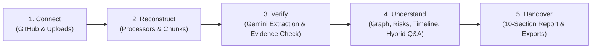

# ProjectX (Capture. Understand. Handover.)

**AI-powered knowledge hub that turns scattered engineering project knowledge into verifiable, evidence-linked handover reports.**

[](https://www.python.org/downloads/release/python-3120/)
[](https://fastapi.tiangolo.com)
[](https://www.postgresql.org/)
[](https://qdrant.tech/)
[](https://github.com/astral-sh/ruff)

---

## 1. Overview & Core Differentiator

When senior engineers depart or projects shift teams, critical context is scattered across disparate GitHub repos, architectural notes, design decisions, and chat threads. Standard LLM summaries frequently hallucinate claims or lose provenance.

**ProjectX solves this with strict evidence linking**:
- **First-Class Evidence**: Every decision, task, risk, and handover narrative claim is linked to an exact verbatim excerpt, source locator (`file_path#L10-L20`), and document hash.
- **Programmatic Verification**: AI extracts knowledge items with exact text excerpts. Before persisting, the backend programmatically verifies that the excerpt exists in the source chunk. If evidence cannot be verified, it is flagged as `[UNVERIFIED_EVIDENCE]`.
- **Hybrid Retrieval**: Combines dense semantic vector search in Qdrant with PostgreSQL full-text keyword search and Reciprocal Rank Fusion (RRF), strictly partitioned by tenant `project_id`.
- **Actionable Continuation Plan**: Generates a 10-section structured handover report detailing completed work, blocked tasks, architectural decisions, single points of knowledge (SPOK), and prioritized next steps.
- **Immutable Sign-Off**: Handover reports transition through review states; once marked `approved`, reports become immutable with cryptographic audit trails and multi-format exports (Markdown, PDF, DOCX).

---

## 2. Technology Stack

- **Runtime & Language**: Python 3.12
- **Web Framework**: FastAPI (fully asynchronous) with Uvicorn
- **Package & Environment Manager**: [uv](https://docs.astral.sh/uv/) (Astral)
- **Relational Database**: PostgreSQL 17 via SQLAlchemy 2.0 (async) & `asyncpg`
- **Schema Migrations**: Alembic (asynchronous environment)
- **Data Validation & Settings**: Pydantic v2 & `pydantic-settings`
- **Security & Passwords**: Argon2id hashing via `pwdlib[argon2]`, JWT access tokens via `pyjwt[crypto]`
- **Vector Search Engine**: Qdrant (`qdrant-client` async)
- **Graph Database**: Neo4j (optional, disabled by default behind compose profile)
- **LLM Integration**: Google Gemini via official `google-genai` SDK (`gemini-2.5-flash` & `text-embedding-004`)
- **Document Processors**: `pypdf`, `python-docx`, `python-pptx`, `tiktoken`, `reportlab`
- **Testing & Quality**: `pytest`, `pytest-asyncio`, `respx`, `ruff`
- **Containerization**: Docker & Docker Compose v2

---

## 3. Architecture & Modular Monolith

ProjectX is architected as a **modular monolith** with strict layer separation:

```
backend/app/
├── core/          # Settings, Argon2/JWT security, Rate Limiter, RequestID, Structured Logging
├── db/            # Base models, async connection pooling, session factory, get_db dependency
├── models/        # SQLAlchemy 2.0 entities (UUID PKs, timezone-aware timestamps, foreign cascades)
├── schemas/       # Pydantic v2 validation, serialization, and OpenAPI contracts
├── api/v1/        # Presentation layer: auth, projects, sources, knowledge, graph, handover
├── services/      # Business logic: ingestion, extraction, retrieval, graph, handover, export, audit
├── integrations/  # External adapters: Gemini, Qdrant, GitHub, Neo4j, Demo AI mock
├── processors/    # File processors: PDF, Markdown, DOCX, PPTX, plain text, Code (Python, TS/JS)
└── workers/       # Standalone ingestion worker using PostgreSQL row locking (SKIP LOCKED)
```

### Architectural Pipeline



---

## 4. Environment Variables Reference

Configure environment settings in `backend/.env` (see `backend/.env.example`):

| Variable | Default Value | Description |
| :--- | :--- | :--- |
| `PROJECT_NAME` | `"ProjectX Backend"` | Name displayed in OpenAPI documentation |
| `ENVIRONMENT` | `"development"` | `development`, `staging`, or `production` |
| `DEBUG` | `true` | Enables detailed error reporting and debug endpoints |
| `DEMO_MODE` | `false` | Enables realistic canned offline AI responses without Gemini API spend |
| `API_V1_STR` | `"/api/v1"` | URL prefix for v1 API routes |
| `SECRET_KEY` | *(min 32 bytes hex)* | Secret used to sign JWT access tokens |
| `ACCESS_TOKEN_EXPIRE_MINUTES` | `1440` | JWT expiration duration (24 hours) |
| `ALGORITHM` | `"HS256"` | JWT signing algorithm |
| `POSTGRES_SERVER` | `"localhost"` | PostgreSQL server hostname |
| `POSTGRES_PORT` | `5432` | PostgreSQL port |
| `POSTGRES_USER` | `"projectx"` | PostgreSQL username |
| `POSTGRES_PASSWORD` | `"projectx_secret"` | PostgreSQL password |
| `POSTGRES_DB` | `"projectx"` | PostgreSQL database name |
| `DATABASE_URL` | *(composite asyncpg)* | Primary asynchronous database connection string |
| `TEST_DATABASE_URL` | *(composite test DB)* | Isolated test database connection string |
| `DB_POOL_SIZE` | `20` | Database connection pool size |
| `DB_MAX_OVERFLOW` | `10` | Maximum overflow connections allowed |
| `DB_POOL_TIMEOUT_SECONDS` | `30.0` | Connection pool checkout timeout |
| `DB_POOL_PRE_PING` | `true` | Validates connections before checkout (avoids stale sockets) |
| `RATE_LIMIT_ENABLED` | `true` | Toggles in-memory request rate limiting |
| `RATE_LIMIT_REQUESTS_PER_MINUTE` | `60` | Global rate limit per client IP |
| `RATE_LIMIT_EXPENSIVE_PER_MINUTE`| `15` | Limit for expensive endpoints (`/search`, `/handover`, `/reindex`) |
| `QDRANT_HOST` | `"localhost"` | Qdrant vector database hostname |
| `QDRANT_PORT` | `6333` | Qdrant vector database HTTP port |
| `QDRANT_COLLECTION_NAME` | `"projectx_knowledge"`| Qdrant collection name |
| `GEMINI_API_KEY` | `""` | Official Google Gemini API key |
| `GEMINI_MODEL` | `"gemini-2.5-flash"` | Gemini text generation and structured extraction model |
| `GEMINI_EMBEDDING_MODEL` | `"text-embedding-004"`| Official Gemini text embedding model |
| `GEMINI_EMBEDDING_DIMENSION` | `768` | Embedding dimensionality (768 for text-embedding-004) |
| `GITHUB_ACCESS_TOKEN` | `""` | Default GitHub token fallback for repository ingestion |
| `STORAGE_DIR` | `"data/storage"` | Directory for local file storage abstraction |
| `MAX_UPLOAD_SIZE_BYTES` | `26214400` | Maximum file upload size (25 MB) |
| `NEO4J_ENABLED` | `false` | Enables optional Neo4j graph mirroring (disabled by default) |

---

## 5. Quickstart & Installation

### Option A: Single-Command Docker Compose (Recommended)

Bring up the complete production-style environment in one command:
```bash
docker compose up -d
```
This automatically boots:
1. **PostgreSQL 17** (with healthcheck)
2. **Qdrant Vector DB** (with TCP readyz probe)
3. **ProjectX API** (runs `alembic upgrade head` on start, serves on `:8000`)
4. **ProjectX Background Worker** (polls ingestion jobs with row-level locks)

Access the services:
- **API Health**: [http://localhost:8000/health](http://localhost:8000/health)
- **Interactive Swagger UI**: [http://localhost:8000/api/v1/docs](http://localhost:8000/api/v1/docs)
- **ReDoc Contract**: [http://localhost:8000/api/v1/redoc](http://localhost:8000/api/v1/redoc)

---

### Option B: Local Native Setup (with `uv`)

#### 1. Prerequisites
- Python 3.12
- [uv](https://docs.astral.sh/uv/) (`curl -LsSf https://astral.sh/uv/install.sh | sh`)
- Docker (for PostgreSQL & Qdrant dependencies)

#### 2. Start PostgreSQL & Qdrant
```bash
docker compose up -d postgres qdrant
```

#### 3. Install Dependencies
```bash
cd backend
uv sync
```

#### 4. Run Alembic Migrations
```bash
cd backend
uv run alembic upgrade head
```

#### 5. Start the FastAPI API Server
```bash
cd backend
uv run uvicorn app.main:app --reload --port 8000
```

#### 6. Start the Ingestion Worker
In a separate terminal:
```bash
cd backend
uv run python -m app.workers.ingestion_worker
```

---

## 6. Demo Seed Script (3-Second Setup)

To instantly populate the database with a realistic demo user, project, synthetic sources, verified knowledge items, blocked tasks, and an approved Handover Report:

```bash
cd backend
uv run python -m scripts.seed_demo
```

### Pre-Seeded Credentials:
- **User Email**: `demo@projectx.dev`
- **Password**: `DemoUser123!`
- **Project**: "Chronos Workflow Engine" (4 documents, 6 verified knowledge items, tasks, risks, and Handover Report v1).

---

## 7. The 5-Step Demo Walkthrough

### Step 1: Connect (Source Onboarding)
Connect knowledge sources via GitHub or direct multi-format file uploads:
```bash
# Login
TOKEN=$(curl -s -X POST http://localhost:8000/api/v1/auth/login \
  -H "Content-Type: application/json" \
  -d '{"email":"demo@projectx.dev","password":"DemoUser123!"}' | jq -r .access_token)

# Upload architecture document
curl -X POST http://localhost:8000/api/v1/projects/<PROJECT_ID>/sources/upload \
  -H "Authorization: Bearer $TOKEN" \
  -F "files=@docs/ARCHITECTURE.md"
```

### Step 2: Reconstruct (Processing & Chunking)
Enqueue a background ingestion job:
```bash
curl -X POST http://localhost:8000/api/v1/projects/<PROJECT_ID>/ingestion/jobs \
  -H "Authorization: Bearer $TOKEN" \
  -H "Content-Type: application/json" \
  -d '{"source_ids":["<SOURCE_ID>"]}'
```
The ingestion worker handles file parsing (page-aware PDF, heading-aware Markdown, DOCX, PPTX, code), calculates SHA-256 hashes, generates line locators, and chunks tokens with overlap.

### Step 3: Verify (AI Extraction & Evidence Verification)
Knowledge items are categorized into `decision`, `task`, `risk`, `milestone`, and `insight`:
- Each item has `exact_evidence_excerpt`.
- The verifier programmatically verifies the excerpt against the raw chunk text.
- Reviewers approve or reject items:
```bash
curl -X POST http://localhost:8000/api/v1/projects/<PROJECT_ID>/knowledge/<ITEM_ID>/review \
  -H "Authorization: Bearer $TOKEN" \
  -H "Content-Type: application/json" \
  -d '{"review_status":"approved","review_note":"Verified by team lead."}'
```

### Step 4: Understand (Search, Graph, Risks, Timeline)
- **Contextual Q&A**: Hybrid dense vector + keyword search returning verifiable inline citations:
  ```bash
  curl -X POST http://localhost:8000/api/v1/projects/<PROJECT_ID>/search \
    -H "Authorization: Bearer $TOKEN" \
    -H "Content-Type: application/json" \
    -d '{"question":"Why did we choose PostgreSQL?","include_answer":true}'
  ```
- **Dependency Graph**: Cycle detection and blocked chains computed via PostgreSQL recursive CTEs:
  ```bash
  curl -X GET http://localhost:8000/api/v1/projects/<PROJECT_ID>/dependencies/graph \
    -H "Authorization: Bearer $TOKEN"
  ```
- **Risk Analytics**: Combined extracted risks and computed signals (overdue tasks, single point of knowledge):
  ```bash
  curl -X GET http://localhost:8000/api/v1/projects/<PROJECT_ID>/risks \
    -H "Authorization: Bearer $TOKEN"
  ```

### Step 5: Handover (Report Generation & Sign-Off)
Generate an evidence-linked 10-section continuation plan:
```bash
curl -X POST http://localhost:8000/api/v1/projects/<PROJECT_ID>/handover \
  -H "Authorization: Bearer $TOKEN" \
  -H "Content-Type: application/json" \
  -d '{"departing_member_name":"Dave Miller","focus_area":"Core Engine"}'
```
Approve the report to lock immutability:
```bash
curl -X POST http://localhost:8000/api/v1/projects/<PROJECT_ID>/handover/<REPORT_ID>/review \
  -H "Authorization: Bearer $TOKEN" \
  -H "Content-Type: application/json" \
  -d '{"action":"approve","comment":"Final sign-off by director."}'
```
Export to executive formats:
- **Markdown**: `GET /api/v1/projects/<PROJECT_ID>/handover/<REPORT_ID>/export/markdown`
- **PDF**: `GET /api/v1/projects/<PROJECT_ID>/handover/<REPORT_ID>/export/pdf`
- **Word DOCX**: `GET /api/v1/projects/<PROJECT_ID>/handover/<REPORT_ID>/export/docx`

---

## 8. Mock-Friendly Demo Mode

To develop or demo the frontend without setting up a Google Gemini API key:
```bash
# In backend/.env:
DEMO_MODE=true
```
- When `DEMO_MODE=true`: The backend returns realistic synthetic AI responses for extraction, grounded Q&A, and handover generation. All demo outputs are explicitly prefixed with `[DEMO_MODE]`.
- When `DEMO_MODE=false`: The backend strictly requires a valid `GEMINI_API_KEY` and raises clear errors on failure. It **never silently falls back** to mock data in real mode.

---

## 9. Running Tests & Code Quality

Run the comprehensive test suite:
```bash
cd backend
uv run pytest
```

Run linter and formatting checks:
```bash
cd backend
uv run ruff check .
uv run ruff format --check .
```

---

## 10. Operational Hardening & Robustness

1. **Request ID Tracing**:
   Every incoming request is assigned or preserves an `X-Request-ID` header, injected into all log records and response headers alongside latency `X-Process-Time-Ms`.
2. **Sensitive Secret Masking**:
   The logging pipeline includes regex-based filters that mask Bearer tokens, GitHub personal access tokens (`ghp_`), Gemini API keys (`AIza...`), and passwords.
3. **Sliding-Window Rate Limiting**:
   Protects expensive endpoints (`/search`, `/handover`, `/reindex`, `/ingestion/jobs`) with HTTP 429 and `Retry-After: 60` headers.
4. **Upload Defense**:
   Validates extensions against an allowlist, enforces size limits (25 MB), and sanitizes filenames against directory traversal (`../`).
5. **Database Connection Pooling**:
   Configured with `pool_size=20`, `max_overflow=10`, `pool_timeout=30.0`, and `pool_pre_ping=true`.

---

## 11. Known Limitations & Future Scope

- **Object Storage**: The current storage abstraction uses local disk (`LocalStorageBackend`); future scope includes pluggable AWS S3 and Google Cloud Storage drivers.
- **Realtime Job Push**: Progress is currently polled via HTTP; future iterations will support WebSockets or Server-Sent Events (SSE) for realtime chunk progress.
- **Connectors**: Next connector plugins to be introduced: Slack channel parser, Jira issue tracker, and Google Drive folder synchronization.
