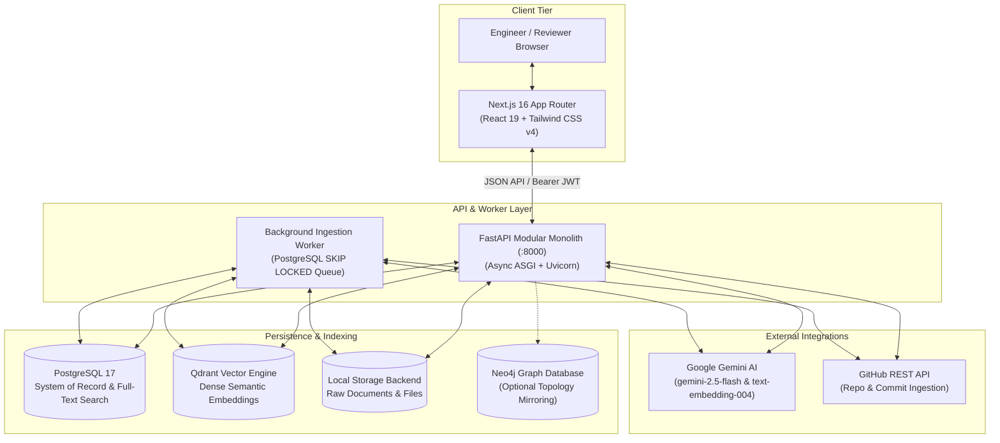
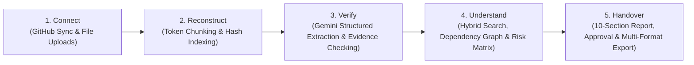

# ProjectX (Capture. Understand. Handover.)

**AI-powered engineering knowledge hub that transforms scattered codebases, documentation, architectural decisions, and commit histories into verifiable, evidence-linked handover reports and continuation plans.**

[](https://opensource.org/licenses/MIT)
[](https://www.python.org/downloads/release/python-3120/)
[](https://fastapi.tiangolo.com)
[](https://nextjs.org/)
[](https://react.dev/)
[](https://tailwindcss.com/)
[](https://www.postgresql.org/)
[](https://qdrant.tech/)
[](https://ai.google.dev/)
[](https://github.com/astral-sh/ruff)
[](https://www.docker.com/)

---

## Table of Contents

1. [Overview & Core Differentiator](#1-overview--core-differentiator)
2. [System Architecture](#2-system-architecture)
   - [High-Level Architecture Diagram](#high-level-architecture-diagram)
   - [End-to-End Knowledge Pipeline](#end-to-end-knowledge-pipeline)
   - [Backend Layering (Modular Monolith)](#backend-layering-modular-monolith)
   - [Frontend Architecture (Feature-Driven Next.js)](#frontend-architecture-feature-driven-nextjs)
3. [Key Capabilities & Features](#3-key-capabilities--features)
4. [Technology Stack](#4-technology-stack)
5. [Repository Structure](#5-repository-structure)
6. [Quickstart & Installation](#6-quickstart--installation)
   - [Option A: Docker Compose (All-in-One)](#option-a-docker-compose-all-in-one-recommended)
   - [Option B: Local Native Setup (uv + Node.js)](#option-b-local-native-setup-uv--nodejs)
7. [Demo Walkthrough & Seeding](#7-demo-walkthrough--seeding)
8. [Configuration & Environment Variables](#8-configuration--environment-variables)
9. [API Contract & Endpoints Guide](#9-api-contract--endpoints-guide)
10. [Testing & Quality Assurance](#10-testing--quality-assurance)
11. [Operational Hardening & Security](#11-operational-hardening--security)
12. [License (MIT)](#12-license-mit)

---

## 1. Overview & Core Differentiator

When senior engineers depart or projects transfer ownership across teams, critical context is routinely lost. Architectural trade-offs, incomplete refactors, known operational hazards, and single points of failure remain trapped in disconnected GitHub pull requests, architecture notes, Slack channels, and implicit team knowledge.

Standard LLM summaries exacerbate this problem by **hallucinating facts, inventing non-existent APIs, and omitting provenance**.

**ProjectX solves this with strict evidence linking**:

- **First-Class Evidence Model**: Every architectural decision, task, risk, and handover narrative claim is backed by a first-class entity with an exact verbatim excerpt, source locator (`file_path#L10-L20` or `file_path#chunk-N`), document hash, and confidence score.
- **Programmatic Excerpt Verification**: When Gemini extracts knowledge items, the ingestion service programmatically verifies that the excerpt exists in the source text chunk using exact, normalized, hyphenation-aware, and fuzzy sequence matching. Unverified items are tagged with `[UNVERIFIED_EVIDENCE]`.
- **Tenant-Partitioned Hybrid Retrieval**: Combines Qdrant dense vector similarity (`text-embedding-004` / 768 dimensions) with PostgreSQL full-text keyword search and Reciprocal Rank Fusion (RRF), strictly partitioned by `project_id`.
- **Actionable 10-Section Handover Report**: Generates structured, citation-grounded continuation plans covering completed milestones, blocked tasks, architectural decisions, single points of knowledge (SPOK), unresolved conflicts, and prioritized continuation items.
- **Multi-Stage Review & Immutable Sign-Off**: Handover reports transition through review states (`draft` &rarr; `in_review` &rarr; `approved`). Once marked `approved`, reports are cryptographically locked and immutable; any regeneration creates version `N + 1` with visual diff comparisons.
- **Executive Multi-Format Exports**: One-click generation of polished Markdown, formatted PDF documents (via ReportLab with evidence appendices), and Microsoft Word `.docx` reports (via python-docx).

---

## 2. System Architecture

ProjectX is designed as a modern decoupled full-stack platform: a high-performance **FastAPI modular monolith** backend and a responsive **Next.js 16 (React 19)** frontend with dedicated background worker queues and storage engines.

### High-Level Architecture Diagram



---

### End-to-End Knowledge Pipeline



1. **Connect**: Connect GitHub repositories via Personal Access Tokens or upload multi-format documentation (`.pdf`, `.md`, `.docx`, `.pptx`, `.txt`, `.py`, `.ts`, `.js`, `.json`, `.yaml`).
2. **Reconstruct**: Extract text preserving page/heading boundaries, compute SHA-256 hashes, and chunk using `tiktoken` (800-token window with 150-token overlap).
3. **Verify**: Gemini parses chunks into structured `decision`, `task`, `risk`, `milestone`, and `insight` items with verbatim excerpts. The backend programmatically confirms each excerpt's presence in the raw chunk.
4. **Understand**: Synthesize project intelligence into an interactive dependency graph with cycle detection, a risk analytics matrix (incorporating git single-author SPOK signals), and hybrid contextual Q&A with inline citations.
5. **Handover**: Synthesize a 10-section continuation plan highlighting departing team members, route through a reviewer sign-off workflow, and export to Markdown, PDF, or Word DOCX.

---

### Backend Layering (Modular Monolith)

The backend code in [`backend/app/`](file:///home/aniketbhil/ProjectX/backend/app) enforces strict separation of concerns:

| Directory | Layer | Description |
| :--- | :--- | :--- |
| [`core/`](file:///home/aniketbhil/ProjectX/backend/app/core) | Infrastructure | Configuration (`pydantic-settings`), Argon2id hashing, JWT auth, rate limiting, request tracing, and structured logging. |
| [`db/`](file:///home/aniketbhil/ProjectX/backend/app/db) | Database Base | Async SQLAlchemy engine, connection pooling (`pool_size=20`, `pre_ping=true`), session lifecycle dependencies. |
| [`models/`](file:///home/aniketbhil/ProjectX/backend/app/models) | Data Domain | UUID-keyed declarative models with timezone-aware audit timestamps, foreign cascades, and relational schemas. |
| [`schemas/`](file:///home/aniketbhil/ProjectX/backend/app/schemas) | API Contracts | Pydantic v2 validation, serialization models, and OpenAPI request/response schemas. |
| [`api/v1/`](file:///home/aniketbhil/ProjectX/backend/app/api/v1) | Presentation | Thin HTTP endpoints enforcing RBAC dependencies, rate limiting, query parameter validation, and response status codes. |
| [`services/`](file:///home/aniketbhil/ProjectX/backend/app/services) | Business Logic | Transaction orchestration, verification engine, hybrid retrieval, graph traversal, and handover report compilation. |
| [`integrations/`](file:///home/aniketbhil/ProjectX/backend/app/integrations) | Adapters | External client adapters for Google Gemini, Qdrant vector database, GitHub API, and optional Neo4j. |
| [`processors/`](file:///home/aniketbhil/ProjectX/backend/app/processors) | File Parsing | Content transformation for PDF, Markdown, Word DOCX, PowerPoint PPTX, plain text, and code (Python, TS/JS). |
| [`workers/`](file:///home/aniketbhil/ProjectX/backend/app/workers) | Background Queue | Independent background ingestion worker using `SELECT ... FOR UPDATE SKIP LOCKED` and automatic stuck-job recovery. |

---

### Frontend Architecture (Feature-Driven Next.js)

The frontend in [`frontend/src/`](file:///home/aniketbhil/ProjectX/frontend/src) is organized into cohesive feature domains with shared UI components:

```
frontend/src/
├── app/                        # Next.js 16 App Router (Layouts, Server Pages, Route Handlers)
│   ├── (auth)/                 # Login and Registration routes
│   ├── app/                    # Authenticated workspace shell
│   │   ├── projects/           # Project directory & creation
│   │   └── projects/[id]/      # Project-specific feature views
│   └── api/                    # Next.js BFF (Backend-for-Frontend) session handlers
├── features/                   # Domain-driven feature modules
│   ├── activity/               # Audit trail feed & event filtering
│   ├── graph/                  # Interactive dependency graph canvas & cycle detection
│   ├── handover/               # Handover Studio: generation, diffing, reviews & exports
│   ├── knowledge/              # Knowledge hub: item cards, evidence viewer & review controls
│   ├── risks/                  # Risk detection matrix & SPOK indicators
│   ├── search/                 # Contextual grounded Q&A with verifiable citation drawer
│   ├── settings/               # Project configuration & RBAC team member management
│   ├── sources/                # Source manager: GitHub connector & multi-file dropzone
│   ├── tasks/                  # Task board & dependency blocker tracking
│   └── timeline/               # Chronological project milestones & decision stream
├── components/                 # Reusable atomic UI & layout primitives (Tailwind CSS v4)
└── lib/                        # Server & client HTTP utilities, auth cookies, and error envelopes
```

---

## 3. Key Capabilities & Features

### 1. Multi-Format Source Ingestion & GitHub Sync
- **Native Document Support**: Ingests PDF (`pypdf` with page preservation), Markdown (heading-aware section splitting), Word (`python-docx`), PowerPoint (`python-pptx`), plain text, and source code (`.py`, `.ts`, `.js`, `.json`, `.yaml`).
- **Direct GitHub Repository Integration**: Connects via URL and personal access token, recursively fetches project trees, filters binary/vendor noise, and captures commit histories for author attribution.
- **Deduplication & Integrity**: Generates SHA-256 hashes per document to avoid redundant reprocessing.

### 2. Programmatic Evidence Verification
- **Verbatim Excerpt Validation**: Compares extracted claims against chunk text through a multi-pass pipeline:
  1. Exact verbatim substring match
  2. Whitespace and line-break normalized match
  3. Case-insensitive match
  4. Hyphenation-rejoined match (handles PDF column line breaks)
  5. Punctuation and markdown stripped match
  6. Fuzzy sequence matching (`SequenceMatcher` with configurable similarity threshold &ge; 0.75)
- **Visual Confidence & Provenance**: Disclose origin (`explicit_fact` vs `ai_inference`), confidence ratings, and exact file locators.

### 3. Contextual Hybrid Search & Grounded Q&A
- **Reciprocal Rank Fusion (RRF)**: Merges dense semantic vector similarity from Qdrant with full-text search rankings from PostgreSQL.
- **Tenant Isolation**: Every vector payload in Qdrant and record in PostgreSQL is filtered by `project_id`.
- **Inline Verifiable Citations**: LLM responses embed clickable citation pills `[1]`, `[2]` linking directly to verbatim excerpts and source files.

### 4. Interactive Dependency Graph & Cycle Detection
- **Recursive CTE Graph Traversal**: Computes subgraphs, dependency depths, and critical blocker paths in PostgreSQL without requiring an external graph database.
- **Cycle & Blocker Detection**: Identifies circular dependencies and high-risk paths blocking task delivery.
- **Optional Neo4j Mirror**: Enables live sync with a Neo4j graph database for advanced Cypher queries when activated.

### 5. Risk Analytics & Single Points of Knowledge (SPOK)
- **Computed Risk Signals**: Flags unassigned critical tasks, overdue deliverables, and circular blockers.
- **Git Author Analysis**: Automatically calculates single-author concentrations (SPOK) to highlight critical components maintained solely by a departing developer.

### 6. Handover Studio & Actionable Continuation Plan
- **10 Structured Sections**:
  1. `project_overview` &mdash; High-level scope, mission, and current status.
  2. `completed_work` &mdash; Delivered features, merged PRs, and realized capabilities.
  3. `pending_and_blocked_tasks` &mdash; Incomplete work items and active blockers.
  4. `key_decisions` &mdash; Architectural and technology trade-offs with rationales.
  5. `open_risks` &mdash; Identified technical, operational, and staffing hazards.
  6. `dependencies` &mdash; Critical path dependencies and external system integrations.
  7. `knowledge_gaps` &mdash; Undocumented areas and open technical questions.
  8. `conflicts` &mdash; Contradictory decisions or competing project priorities.
  9. `continuation_plan` &mdash; Step-by-step roadmap for the onboarding engineer.
  10. `departing_member_knowledge` &mdash; Sole-author repos, assigned tasks, and focus areas.
- **Report Diffing**: Compare generated versions side-by-side to review changes between iterations.
- **Immutable Approval**: Signed off reports are locked against modifications to provide a permanent audit record.
- **Multi-Format Export**: Download reports in raw Markdown, executive PDF, or Word `.docx`.

---

## 4. Technology Stack

| Layer | Technology | Version | Purpose |
| :--- | :--- | :--- | :--- |
| **Backend Framework** | [FastAPI](https://fastapi.tiangolo.com/) | 0.115+ | High-throughput asynchronous REST API |
| **Backend Runtime** | [Python](https://www.python.org/) | 3.12+ | Modern type hints, `StrEnum`, pattern matching |
| **Package Manager** | [uv](https://docs.astral.sh/uv/) | Latest | Fast Python virtual environment and package resolver |
| **Frontend Framework**| [Next.js](https://nextjs.org/) | 16.4+ (App Router) | Server-rendered React application and BFF |
| **UI Library** | [React](https://react.dev/) | 19.3+ | Component tree and concurrent rendering |
| **Styling & Design** | [Tailwind CSS](https://tailwindcss.com/) | v4 | Modern styling engine with dark-mode support |
| **Icons** | [Lucide React](https://lucide.dev/) | Latest | Clean and consistent iconography |
| **Relational DB** | [PostgreSQL](https://www.postgresql.org/) | 17 | Relational system of record and recursive CTEs |
| **ORM / Driver** | [SQLAlchemy](https://www.sqlalchemy.org/) + [asyncpg](https://github.com/MagicStack/asyncpg) | 2.0+ | Fully async database access and schema definitions |
| **Database Migrations**| [Alembic](https://alembic.sqlalchemy.org/) | 1.14+ | Async schema migrations and version tracking |
| **Vector Database** | [Qdrant](https://qdrant.tech/) | Latest | Dense vector search and tenant-filtered indexing |
| **Optional Graph DB** | [Neo4j](https://neo4j.com/) | 5.26 Community | Optional secondary graph mirroring |
| **AI Reasoning & Embed**| [Google Gemini](https://ai.google.dev/) | `gemini-2.5-flash` | Structured knowledge extraction and grounded Q&A |
| **Embedding Model** | [Gemini Embeddings](https://ai.google.dev/) | `text-embedding-004` | 768-dimensional dense document embeddings |
| **Authentication** | Argon2id + JWT | `pwdlib`, `pyjwt` | Cryptographic password hashing and bearer tokens |
| **Document Parsing** | `pypdf`, `python-docx`, `python-pptx` | Latest | Multi-format file reading and structural extraction |
| **Report Generation** | `reportlab`, `python-docx` | Latest | Executive PDF and Word export compilation |
| **Quality & Linting** | [Ruff](https://github.com/astral-sh/ruff) + [ESLint](https://eslint.org/) | Latest | Ultra-fast Python and TypeScript code quality checks |
| **Containers** | Docker & Docker Compose | v2 | Containerized microservice orchestration |

---

## 5. Repository Structure

```
ProjectX/
├── LICENSE                         # MIT License
├── README.md                       # Comprehensive Project Documentation
├── docker-compose.yml              # Complete Multi-Container Orchestration
│
├── backend/                        # FastAPI Backend Application
│   ├── pyproject.toml              # Python dependencies & Ruff/Pytest configuration
│   ├── uv.lock                     # Deterministic dependency lockfile
│   ├── Dockerfile                  # Production container definition
│   ├── alembic.ini                 # Database migration configuration
│   ├── AGENT_RULES.md              # Architectural rules & coding standards
│   ├── alembic/                    # Database migration scripts
│   ├── app/                        # Application Source Code
│   │   ├── main.py                 # FastAPI application factory & lifecycle
│   │   ├── core/                   # Config, security, rate limiting, logging
│   │   ├── db/                     # SQLAlchemy async engine & session management
│   │   ├── models/                 # Relational domain entities
│   │   ├── schemas/                # Pydantic v2 validation contracts
│   │   ├── api/v1/                 # REST endpoints & routing
│   │   ├── services/               # Core business logic & workflows
│   │   ├── integrations/           # External service clients (Gemini, Qdrant, GitHub)
│   │   ├── processors/             # Document parsers (PDF, MD, DOCX, Code)
│   │   ├── prompts/                # Grounded prompt templates
│   │   └── workers/                # Standalone background ingestion worker
│   ├── docs/                       # OpenAPI specifications & API Guide
│   ├── scripts/                    # Database seeding and demo scripts
│   └── tests/                      # Automated pytest suite
│
└── frontend/                       # Next.js 16 Web Application
    ├── package.json                # Frontend dependencies and npm scripts
    ├── tsconfig.json               # TypeScript compiler configuration
    ├── next.config.ts              # Next.js configuration
    ├── eslint.config.mjs           # ESLint configuration
    └── src/
        ├── app/                    # Next.js App Router pages and layout shell
        ├── components/             # Reusable UI cards, dialogs, dropzones
        ├── features/               # Feature-packaged UI modules (sources, graph, handover)
        ├── lib/                    # Server and client HTTP helpers
        └── types/                  # TypeScript interface contracts
```

---

## 6. Quickstart & Installation

### Option A: Docker Compose (All-in-One, Recommended)

Launch the entire ecosystem with a single command:

```bash
docker compose up -d
```

This spins up and healthchecks:
1. **PostgreSQL 17** &mdash; Relational storage on port `5432`.
2. **Qdrant Vector DB** &mdash; Vector engine on port `6333` (REST) and `6334` (gRPC).
3. **ProjectX API** &mdash; Automatically runs migrations (`alembic upgrade head`) and serves on port `8000`.
4. **ProjectX Background Worker** &mdash; Polls and processes background ingestion jobs.

Then start the frontend:
```bash
cd frontend
npm install
npm run dev
```

Open your browser:
- **Web Application**: [http://localhost:3000](http://localhost:3000)
- **API Health Check**: [http://localhost:8000/health](http://localhost:8000/health)
- **Interactive OpenAPI Docs**: [http://localhost:8000/api/v1/docs](http://localhost:8000/api/v1/docs)
- **ReDoc Contract**: [http://localhost:8000/api/v1/redoc](http://localhost:8000/api/v1/redoc)

---

### Option B: Local Native Setup (uv + Node.js)

#### 1. Prerequisites
- **Python 3.12+**
- [**uv**](https://docs.astral.sh/uv/) (Install: `curl -LsSf https://astral.sh/uv/install.sh | sh`)
- **Node.js 20+** and **npm**
- **Docker** (to run PostgreSQL & Qdrant dependencies)

#### 2. Start PostgreSQL and Qdrant
```bash
docker compose up -d postgres qdrant
```

#### 3. Setup Backend
```bash
cd backend

# Create virtual environment and sync dependencies
uv sync

# Configure environment variables
cp .env.example .env

# Apply database migrations
uv run alembic upgrade head

# Start FastAPI API server
uv run uvicorn app.main:app --reload --port 8000
```

In a separate terminal, launch the background ingestion worker:
```bash
cd backend
uv run python -m app.workers.ingestion_worker
```

#### 4. Setup Frontend
In another terminal:
```bash
cd frontend

# Install dependencies
npm install

# Start Next.js development server
npm run dev
```

Visit [http://localhost:3000](http://localhost:3000) to access the application.

---

## 7. Demo Walkthrough & Seeding

### 3-Second Automated Demo Seed

To populate the system with a complete project, synthetic documents, verified knowledge items, blocked tasks, active risks, and an approved Handover Report:

```bash
cd backend
uv run python -m scripts.seed_demo
```

### Pre-Seeded Credentials:
- **Email**: `demo@projectx.dev`
- **Password**: `DemoUser123!`
- **Preloaded Project**: *"Chronos Workflow Engine"* (includes 4 documents, 6 verified knowledge items, task dependencies, risk matrix, and Handover Report v1).

---

### The 5-Step Core Workflow

#### Step 1: Connect (Source Ingestion)
Obtain a JWT token and upload architectural documentation:
```bash
# Authenticate
TOKEN=$(curl -s -X POST http://localhost:8000/api/v1/auth/login \
  -H "Content-Type: application/json" \
  -d '{"email":"demo@projectx.dev","password":"DemoUser123!"}' | jq -r .access_token)

# Connect a GitHub repository
curl -X POST http://localhost:8000/api/v1/projects/<PROJECT_ID>/sources/github \
  -H "Authorization: Bearer $TOKEN" \
  -H "Content-Type: application/json" \
  -d '{"repo_url":"https://github.com/my-org/chronos","branch":"main"}'

# Or upload a document file directly
curl -X POST http://localhost:8000/api/v1/projects/<PROJECT_ID>/sources/upload \
  -H "Authorization: Bearer $TOKEN" \
  -F "files=@docs/ARCHITECTURE.md"
```

#### Step 2: Reconstruct (Processing & Chunking)
Enqueue an ingestion job to parse documents and generate vector embeddings:
```bash
curl -X POST http://localhost:8000/api/v1/projects/<PROJECT_ID>/ingestion/jobs \
  -H "Authorization: Bearer $TOKEN" \
  -H "Content-Type: application/json" \
  -d '{"source_ids":["<SOURCE_ID>"]}'
```

#### Step 3: Verify (AI Extraction & Evidence Review)
Review extracted knowledge items against original document excerpts:
```bash
# Fetch extracted items
curl -X GET "http://localhost:8000/api/v1/projects/<PROJECT_ID>/knowledge?category=decision" \
  -H "Authorization: Bearer $TOKEN"

# Approve a verified item
curl -X POST http://localhost:8000/api/v1/projects/<PROJECT_ID>/knowledge/<ITEM_ID>/review \
  -H "Authorization: Bearer $TOKEN" \
  -H "Content-Type: application/json" \
  -d '{"review_status":"approved","review_note":"Verified by Lead Architect"}'
```

#### Step 4: Understand (Search, Graph & Risks)
Execute hybrid grounded Q&A and inspect project dependencies:
```bash
# Grounded Q&A with verifiable citations
curl -X POST http://localhost:8000/api/v1/projects/<PROJECT_ID>/search \
  -H "Authorization: Bearer $TOKEN" \
  -H "Content-Type: application/json" \
  -d '{"question":"Why was PostgreSQL selected?","include_answer":true}'

# Retrieve the dependency graph with cycle detection
curl -X GET http://localhost:8000/api/v1/projects/<PROJECT_ID>/dependencies/graph \
  -H "Authorization: Bearer $TOKEN"

# Query the risk analytics matrix
curl -X GET http://localhost:8000/api/v1/projects/<PROJECT_ID>/risks \
  -H "Authorization: Bearer $TOKEN"
```

#### Step 5: Handover (Report Generation & Sign-Off)
Compile an evidence-linked handover report, review it, and export:
```bash
# Trigger handover report generation
curl -X POST http://localhost:8000/api/v1/projects/<PROJECT_ID>/handover \
  -H "Authorization: Bearer $TOKEN" \
  -H "Content-Type: application/json" \
  -d '{"departing_member_name":"Dave Miller","focus_area":"Core Engine"}'

# Sign off and approve report (locks report immutability)
curl -X POST http://localhost:8000/api/v1/projects/<PROJECT_ID>/handover/<REPORT_ID>/review \
  -H "Authorization: Bearer $TOKEN" \
  -H "Content-Type: application/json" \
  -d '{"status":"approved","review_comment":"Final handover approved"}'

# Download executive PDF export
curl -X GET http://localhost:8000/api/v1/projects/<PROJECT_ID>/handover/<REPORT_ID>/export/pdf \
  -H "Authorization: Bearer $TOKEN" \
  -o Handover_Report.pdf
```

---

## 8. Configuration & Environment Variables

### Backend Configuration (`backend/.env`)

| Variable | Default Value | Description |
| :--- | :--- | :--- |
| `PROJECT_NAME` | `"ProjectX Backend"` | Name shown in OpenAPI documentation |
| `ENVIRONMENT` | `"development"` | `development`, `staging`, or `production` |
| `DEBUG` | `true` | Enables detailed debug logs and exception details |
| `DEMO_MODE` | `false` | When `true`, returns synthetic offline AI responses without Gemini API spend |
| `API_V1_STR` | `"/api/v1"` | URL prefix for v1 API routes |
| `SECRET_KEY` | *(32+ byte hex)* | Cryptographic secret for signing JWT tokens |
| `ACCESS_TOKEN_EXPIRE_MINUTES` | `1440` | JWT token validity duration (24 hours) |
| `ALGORITHM` | `"HS256"` | JWT token signature algorithm |
| `POSTGRES_SERVER` | `"localhost"` | PostgreSQL hostname |
| `POSTGRES_PORT` | `5432` | PostgreSQL port |
| `POSTGRES_USER` | `"projectx"` | PostgreSQL user |
| `POSTGRES_PASSWORD` | `"projectx_secret"` | PostgreSQL password |
| `POSTGRES_DB` | `"projectx"` | PostgreSQL database name |
| `DATABASE_URL` | *(composite asyncpg)* | Asynchronous database connection string |
| `DB_POOL_SIZE` | `20` | SQLAlchemy connection pool size |
| `DB_MAX_OVERFLOW` | `10` | SQLAlchemy maximum overflow connections |
| `DB_POOL_TIMEOUT_SECONDS` | `30.0` | Connection checkout timeout |
| `DB_POOL_PRE_PING` | `true` | Validates connections before checkout |
| `RATE_LIMIT_ENABLED` | `true` | Enables in-memory sliding-window rate limiting |
| `RATE_LIMIT_REQUESTS_PER_MINUTE` | `60` | Global rate limit per client IP |
| `RATE_LIMIT_EXPENSIVE_PER_MINUTE`| `15` | Limit for intensive endpoints (`/search`, `/handover`) |
| `QDRANT_HOST` | `"localhost"` | Qdrant host |
| `QDRANT_PORT` | `6333` | Qdrant HTTP port |
| `QDRANT_COLLECTION_NAME` | `"projectx_knowledge"`| Qdrant collection name |
| `GEMINI_API_KEY` | `""` | Official Google Gemini API key |
| `GEMINI_MODEL` | `"gemini-2.5-flash"` | Gemini text generation and extraction model |
| `GEMINI_EMBEDDING_MODEL` | `"text-embedding-004"`| Gemini embedding model |
| `GEMINI_EMBEDDING_DIMENSION` | `768` | Embedding dimensionality (768 for text-embedding-004) |
| `GITHUB_ACCESS_TOKEN` | `""` | Default GitHub token fallback for repository ingestion |
| `STORAGE_DIR` | `"data/storage"` | Local filesystem directory for file storage |
| `MAX_UPLOAD_SIZE_BYTES` | `26214400` | Maximum file upload size (25 MB) |
| `CHUNK_SIZE_TOKENS` | `800` | Target token count per text chunk |
| `CHUNK_OVERLAP_TOKENS` | `150` | Overlap tokens between adjacent chunks |
| `NEO4J_ENABLED` | `false` | Enables optional Neo4j graph database mirroring |

### Frontend Configuration (`frontend/.env.local`)

| Variable | Default Value | Description |
| :--- | :--- | :--- |
| `PROJECTX_API_BASE_URL` | `http://localhost:8000/api/v1` | URL pointing to the FastAPI backend |

---

## 9. API Contract & Endpoints Guide

The backend provides a complete RESTful API under the `/api/v1` prefix:

| Module | Method | Endpoint | Access Role | Description |
| :--- | :--- | :--- | :--- | :--- |
| **Health** | `GET` | `/health` | Public | System health probe (PostgreSQL, Qdrant) |
| **Auth** | `POST` | `/api/v1/auth/register` | Public | Create a new user account |
| **Auth** | `POST` | `/api/v1/auth/login` | Public | Obtain JWT Bearer access token |
| **Auth** | `GET` | `/api/v1/auth/me` | Authenticated | Retrieve current user profile and projects |
| **Projects** | `GET` | `/api/v1/projects` | Authenticated | List all projects the user is a member of |
| **Projects** | `POST` | `/api/v1/projects` | Authenticated | Create a new project (caller becomes `owner`) |
| **Projects** | `GET` | `/api/v1/projects/{id}` | Viewer+ | Retrieve project details and membership |
| **Sources** | `POST` | `/api/v1/projects/{id}/sources/github` | Admin+ | Connect and sync a GitHub repository |
| **Sources** | `POST` | `/api/v1/projects/{id}/sources/upload` | Member+ | Upload multi-format documents (PDF, MD, DOCX) |
| **Sources** | `GET` | `/api/v1/projects/{id}/sources` | Viewer+ | List connected project sources and documents |
| **Ingestion** | `POST` | `/api/v1/projects/{id}/ingestion/jobs` | Member+ | Trigger asynchronous chunking and indexing |
| **Ingestion** | `GET` | `/api/v1/projects/{id}/ingestion/jobs` | Viewer+ | Poll ingestion progress and status |
| **Knowledge** | `GET` | `/api/v1/projects/{id}/knowledge` | Viewer+ | Search and filter extracted knowledge items |
| **Knowledge** | `GET` | `/api/v1/projects/{id}/knowledge/{item_id}` | Viewer+ | Inspect item with verbatim evidence excerpts |
| **Knowledge** | `POST` | `/api/v1/projects/{id}/knowledge/{item_id}/review` | Reviewer+ | Approve or reject an extracted item |
| **Search** | `POST` | `/api/v1/projects/{id}/search` | Viewer+ | Hybrid vector+keyword Q&A with citations |
| **Graph** | `GET` | `/api/v1/projects/{id}/dependencies/graph` | Viewer+ | Dependency graph with cycle and blocker analysis |
| **Risks** | `GET` | `/api/v1/projects/{id}/risks` | Viewer+ | Risk matrix including single-author SPOK |
| **Timeline** | `GET` | `/api/v1/projects/{id}/timeline` | Viewer+ | Chronological milestones and releases |
| **Tasks** | `GET` | `/api/v1/projects/{id}/tasks` | Viewer+ | Task board with blocking dependencies |
| **Handover** | `POST` | `/api/v1/projects/{id}/handover` | Member+ | Generate 10-section continuation plan |
| **Handover** | `GET` | `/api/v1/projects/{id}/handover` | Viewer+ | Retrieve the latest handover report |
| **Handover** | `POST` | `/api/v1/projects/{id}/handover/{report_id}/review` | Reviewer+ | Review, approve, or reject handover report |
| **Handover** | `GET` | `/api/v1/projects/{id}/handover/{report_id}/export/{format}` | Viewer+ | Export to `markdown`, `pdf`, or `docx` |
| **Activity** | `GET` | `/api/v1/projects/{id}/activity` | Viewer+ | Immutable audit trail and event stream |

For the complete API contract and payload examples, see [`backend/docs/API_GUIDE.md`](file:///home/aniketbhil/ProjectX/backend/docs/API_GUIDE.md) and the interactive Swagger UI at `http://localhost:8000/api/v1/docs`.

---

## 10. Testing & Quality Assurance

### Backend Tests & Linting

```bash
cd backend

# Run the complete automated test suite
uv run pytest

# Run linter and formatting checks with Ruff
uv run ruff check .
uv run ruff format --check .
```

### Frontend Typecheck & Linting

```bash
cd frontend

# Run ESLint across Next.js and React source
npm run lint

# Compile production build
npm run build
```

---

## 11. Operational Hardening & Security

1. **Request Tracing & Latency**: Every HTTP request receives or forwards an `X-Request-ID` header, correlated across all structured log records alongside latency (`X-Process-Time-Ms`).
2. **Credential & Secret Masking**: The logging pipeline automatically redacts Bearer tokens, GitHub Personal Access Tokens (`ghp_*`), Google Gemini keys (`AIza*`), and passwords.
3. **Sliding-Window Rate Limiter**: Expensive endpoints (`/search`, `/handover`, `/reindex`) are governed by an in-memory rate limiter that returns HTTP `429 Too Many Requests` with a `Retry-After: 60` response header.
4. **Defensive Ingestion**: Strict extension allowlisting (`.pdf`, `.md`, `.docx`, `.pptx`, `.txt`, `.py`, `.ts`, `.js`, `.json`, `.yaml`), maximum 25 MB payload enforcement, and filename sanitization against path traversal (`../`).
5. **Role-Based Access Control (RBAC)**: Hierarchical roles (`viewer` < `member` < `reviewer` < `admin` < `owner`) ensure data isolation and governance across all project actions.

---

## 12. License (MIT)

ProjectX is open-source software licensed under the **[MIT License](file:///home/aniketbhil/ProjectX/LICENSE)**.

```
MIT License

Copyright (c) 2026 ProjectX Contributors

Permission is hereby granted, free of charge, to any person obtaining a copy
of this software and associated documentation files (the "Software"), to deal
in the Software without restriction, including without limitation the rights
to use, copy, modify, merge, publish, distribute, sublicense, and/or sell
copies of the Software, and to permit persons to whom the Software is
furnished to do so, subject to the following conditions:

The above copyright notice and this permission notice shall be included in all
copies or substantial portions of the Software.

THE SOFTWARE IS PROVIDED "AS IS", WITHOUT WARRANTY OF ANY KIND, EXPRESS OR
IMPLIED, INCLUDING BUT NOT LIMITED TO THE WARRANTIES OF MERCHANTABILITY,
FITNESS FOR A PARTICULAR PURPOSE AND NONINFRINGEMENT. IN NO EVENT SHALL THE
AUTHORS OR COPYRIGHT HOLDERS BE LIABLE FOR ANY CLAIM, DAMAGES OR OTHER
LIABILITY, WHETHER IN AN ACTION OF CONTRACT, TORT OR OTHERWISE, ARISING FROM,
OUT OF OR IN CONNECTION WITH THE SOFTWARE OR THE USE OR OTHER DEALINGS IN THE
SOFTWARE.
```
